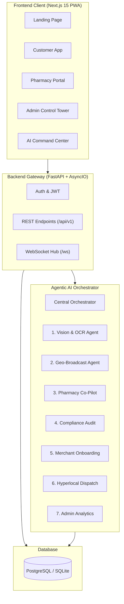

# MediBid AI — Intelligent Hyperlocal Pharmacy Marketplace

[](https://fastapi.tiangolo.com)
[](https://nextjs.org)
[](https://www.typescriptlang.org)
[](https://tailwindcss.com)
[](https://python.org)
[](LICENSE)

> **DEMO ENVIRONMENT NOTICE**: This application is a fully functional demonstration prototype of an AI-native hyperlocal pharmacy bidding marketplace. Integrations (payments, logistics, digital signatures) are simulated for safe demonstration.

---

## 🌟 Overview

**MediBid AI** revolutionizes medicine procurement in India through AI vision extraction and competitive reverse auctions. Instead of calling multiple chemists to check medicine stock and prices, customers simply upload a doctor's prescription. AI extracts the details, broadcasts requests to verified pharmacies within a 1–2 km radius, and lets chemists bid with their best prices and delivery times.

### Core Demonstration Workflow
1. **Prescription Upload**: Customer uploads prescription (JPG, PNG, PDF).
2. **AI Medicine Extraction**: AI vision detects medicine name, strength, dosage, and quantity with confidence metrics.
3. **Hyperlocal Discovery**: Geo-broadcast agent identifies verified pharmacies within 1–2 km.
4. **Live Reverse Auction**: Pharmacies submit itemized bids in a 15-minute countdown room with WebSocket updates.
5. **Selection & Generic Savings**: Customer compares prices, discounts, and delivery speeds to pick the winning bid.
6. **Pharmacist Sign-Off**: Mandatory registered pharmacist review and verification.
7. **Order Dispatch & Tracking**: Simulated rider assignment and delivery milestone tracking.

---

## 🏗️ Architecture



---

## 🔑 Demo Accounts

The database comes pre-seeded with realistic demonstration accounts:

| Role | Email | Password | Access / Features |
|---|---|---|---|
| **Customer** | `customer@medibid.demo` | `demo123456` | Upload prescriptions, start auctions, select offers, track orders |
| **Pharmacy** | `pharmacy@medibid.demo` | `demo123456` | Review incoming requests, submit bids, pharmacist verification |
| **Admin** | `admin@medibid.demo` | `demo123456` | Control tower, pharmacy verification, compliance queue, AI agents |

---

## 🤖 8 AI Agents

1. **Prescription Vision & OCR Agent**: Multi-field medicine extraction with confidence scoring.
2. **Geo-Broadcast & Dynamic Bidding Agent**: Proximity calculation and 1–2 km radius expansion.
3. **Pharmacy Co-Pilot & Pricing Agent**: Unstructured quote ingestion and MRP discount calculations.
4. **Compliance & Substitution Audit Agent**: Drug Schedule (H/H1/X) verification and bio-equivalence audits.
5. **Autonomous Merchant Onboarding Agent**: License and pharmacist registration document parsing.
6. **Hyperlocal Logistics & Dispatch Agent**: Order batching and simulated rider dispatch tracking.
7. **Admin Intelligence & Analytics Agent**: Marketplace liquidity metrics, win rates, and coverage reports.
8. **Central Orchestrator**: LangGraph-inspired stateful coordinator managing the complete lifecycle.

---

## 🚀 Quick Start Guide

### 1. Clone & Set Up Backend
```bash
git clone https://github.com/dolly-balwani/Pharmacy_app.git
cd Pharmacy_app/backend

# Create and activate virtual environment
python -m venv .venv
.\.venv\Scripts\activate   # Windows
# source .venv/bin/activate # macOS/Linux

# Install dependencies and seed demo data
pip install -r requirements.txt
python -m app.db.seed

# Run the API server
uvicorn app.main:app --reload --port 8000
```
API Documentation will be live at: [http://localhost:8000/docs](http://localhost:8000/docs)

### 2. Set Up Frontend
```bash
cd ../frontend

# Install dependencies and start Next.js
npm install --legacy-peer-deps
npm run dev
```
Customer web application will be live at: [http://localhost:3000](http://localhost:3000)

### 3. Run Automated Tests
```bash
cd ../backend
.\.venv\Scripts\python.exe -m pytest -v
```

---

## 📚 Technical Documentation

- [System Architecture](docs/ARCHITECTURE.md)
- [REST API Specification](docs/API.md)
- [AI Agents Deep Dive](docs/AI_AGENTS.md)
- [Database Models & Schema](docs/DATABASE.md)
- [Deployment Guide (Render / Cloud)](docs/DEPLOYMENT.md)
- [Security & DPDP Compliance](docs/SECURITY.md)

---

## 📄 License
This project is licensed under the MIT License.

