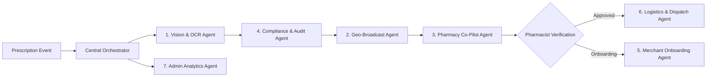

# MediBid AI — AI Agents Specification

MediBid AI employs a multi-agent orchestration architecture consisting of 7 domain-specialized agents and 1 central coordinator.

## Agent Roster & Defined Responsibilities

### 1. Prescription Vision & OCR Agent
- **Model**: Gemini Vision API with structured schema fallback.
- **Inputs**: Prescription image or document (JPG, PNG, PDF).
- **Outputs**: Structured medicines array with name, brand, salt, strength, quantity, dosage instructions, and OCR confidence (0.0 - 1.0).
- **Rule**: Flags Schedule H/H1/X drugs for mandatory review; never fabricates illegible text.

### 2. Geo-Broadcast & Dynamic Bidding Agent
- **Responsibility**: Calculates customer coordinates against verified pharmacies using Haversine indexing.
- **Dynamic Radius**: Defaults to 1 km; auto-expands to 2 km if under 3 pharmacies respond within 5 minutes.
- **Auction Lifecycle**: Manages 15-minute countdowns and closes expired auctions.

### 3. Pharmacy Co-Pilot & Pricing Agent
- **Responsibility**: Ingests unstructured or structured quotations from pharmacy merchants.
- **Validation**: Verifies unit rates against standard MRP ceilings, computes discounts and delivery surcharges, and highlights generic substitute savings.

### 4. Compliance & Substitution Audit Agent
- **Responsibility**: Checks pharmacy Drug License validity metadata and GST filings.
- **Clinical Safety**: Audits proposed generic alternatives for exact active ingredient equivalence, strength match, and dosage formulation compatibility.

### 5. Autonomous Merchant Onboarding Agent
- **Responsibility**: Ingests pharmacy registration documents, extracts license numbers and pharmacist registration certificates, and flags missing documentation.

### 6. Hyperlocal Logistics & Dispatch Agent
- **Responsibility**: Triggers upon verified pharmacist order approval.
- **Assignment**: Simulates courier and rider matching, estimates arrival times, and generates simulated delivery tracking milestones.

### 7. Admin Intelligence & Analytics Agent
- **Responsibility**: Monitors marketplace health, calculates average win rates, detects slow-responding zones, and surfaces compliance exceptions.

### 8. Central Orchestrator
- **Responsibility**: Built with LangGraph patterns to coordinate sequential agent handoffs, maintain workflow execution state, and persist audit logs.

