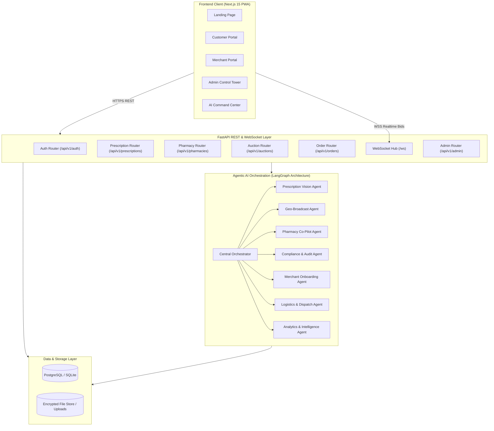

# MediBid AI — System Architecture

MediBid AI is an AI-native hyperlocal pharmacy marketplace designed for India. The platform connects customers with nearby verified pharmacies through competitive reverse bidding and automated AI prescription intelligence.

## 1. High-Level Architecture

## 2. Component Design

### Frontend (Next.js 15 App Router)
- **Design Tokens**: Soft palette with `#F7F9FC` background, `#2563EB` primary, `#38BDF8` accent, `#DDF7ED` mint, `#F1EDFF` lavender.
- **State Management**: React Context (`AuthProvider`) with persistent JWT and auto-routing.
- **Animations**: Framer Motion for card transitions, countdown timers, and live bid arrival states.

### Backend (FastAPI + SQLAlchemy AsyncIO)
- **Async Engine**: SQLite (dev) / PostgreSQL + asyncpg (prod).
- **Authentication**: JWT tokens (HS256) with native bcrypt password hashing.
- **Geospatial Engine**: Haversine distance matching with dynamic radius expansion (1 km default to 2 km fallback).
- **WebSocket Gateway**: In-memory broadcast manager for auction events and new bid pushes.

### AI Orchestrator Layer
- **Agent Coordination**: 8 dedicated agent roles handling vision extraction, geospatial filtering, price validation, compliance audits, logistics dispatch, and admin summaries.
