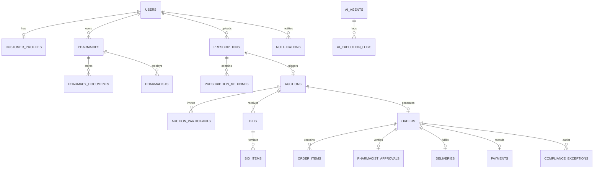

# MediBid AI — Database Architecture

The data architecture uses SQLAlchemy 2.0 with asynchronous drivers (`aiosqlite` for local development, `asyncpg` for production PostgreSQL/Supabase).

## Entity Relationship Overview

## Primary Tables
1. **users**: Core authentication identity (UUID, email, hashed_password, role, is_active).
2. **customer_profiles**: Addresses, default coordinates, city and state.
3. **pharmacies**: Business profile, latitude, longitude, drug license, verification status.
4. **pharmacy_documents**: Uploaded licenses, certificates, verification timestamps.
5. **pharmacists**: Registered pharmacist details and license numbers.
6. **prescriptions**: Document file paths, doctor names, upload status.
7. **prescription_medicines**: Extracted drugs, salt names, strength, dosage, confidence.
8. **auctions**: Active bidding rooms, radius parameters, countdown timers.
9. **auction_participants**: Broadcast logs for nearby pharmacies.
10. **bids**: Pharmacy quotation, discount percentage, delivery fee.
11. **bid_items**: Line-item pricing, availability flags, generic flags.
12. **orders**: Finalized orders progressing through preparation and dispatch.
13. **order_items**: Confirmed medicines and prices.
14. **pharmacist_approvals**: Mandatory pharmacist sign-off with registration numbers.
15. **deliveries**: Rider allocation, simulated tracking status, delivery timestamps.
16. **payments**: Simulated transaction state and amounts.
17. **ai_agents**: Registry of all 8 system agents, status, and success rates.
18. **ai_execution_logs**: Chronological audit trail of agent workflows.
19. **compliance_exceptions**: Regulatory flags requiring human sign-off.
20. **notifications**: In-app notifications for order and bid alerts.
